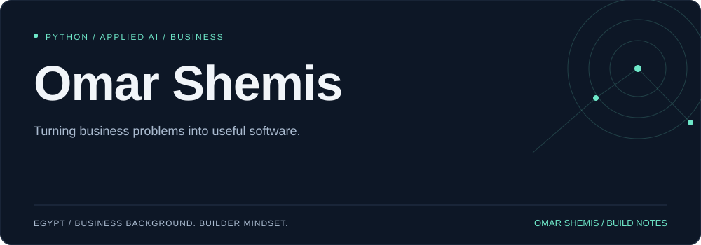
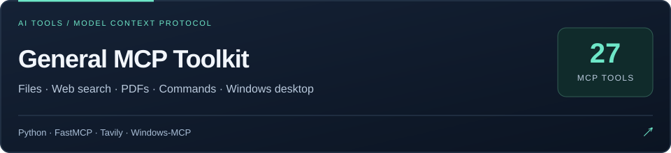
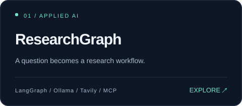
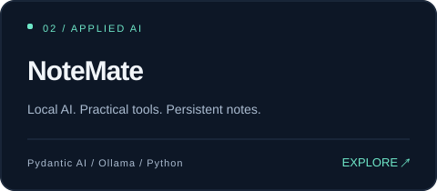
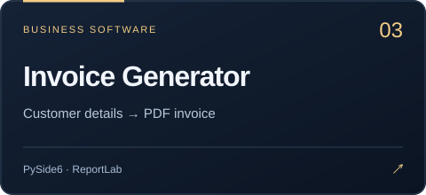
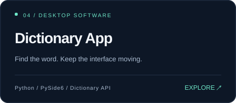

  

  <a href="#selected-work">Selected work</a> &nbsp; / &nbsp;
  <a href="#the-toolbox">The toolbox</a> &nbsp; / &nbsp;
  <a href="#a-little-context">About me</a> &nbsp; / &nbsp;
  <a href="https://github.com/OmarShemis?tab=repositories">All repositories ↗</a>

### Business perspective. Python in practice.

I'm **Omar**, a business administration graduate and former **EY Egypt tax associate** building Python tools and exploring applied AI. Working with finance, reconciliations, and Excel/VBA automation got me interested in making everyday work simpler through software.

Now I'm building local AI assistants, research workflows, and practical desktop tools—while learning the foundations of machine learning.

## Selected work

Five projects that show where I'm heading: AI tooling, research workflows, and practical desktop software. Open a card for the code, setup, and implementation details.

  

**[General MCP Toolkit](https://github.com/OmarShemis/general-mcp-toolkit)** gives MCP-compatible AI clients 27 tools for files, web search, PDF reading, command execution, and Windows desktop automation. Built with Python and FastMCP, it includes atomic file replacements, fractional waits, and regression tests. Desktop tools run on the Windows computer hosting the server.

  
  
  
  

**[ResearchGraph](https://github.com/OmarShemis/researchgraph)** connects planning, web research, review, and writing with LangGraph, Ollama, Tavily, and MCP notes. **[NoteMate](https://github.com/OmarShemis/notemate)** explores local AI with Pydantic AI, persistent notes, and bounded arithmetic tools.

**[Invoice Generator](https://github.com/OmarShemis/invoice-generator)** turns customer details into PDF invoices with decimal calculations and input validation. **[Dictionary App](https://github.com/OmarShemis/dictionary-app)** looks up English words through a desktop interface with background API requests.

### Small tools, useful jobs

| Project | The idea | Built with |
| :--- | :--- | :--- |
| [Expense Tracker](https://github.com/OmarShemis/personal-expense-tracker) | Record expenses and keep them between sessions. | Python · SQLite |
| [News Headline Fetcher](https://github.com/OmarShemis/news-headline-fetcher) | Browse headlines by country and category. | Python · NewsAPI |
| [Image Downloader](https://github.com/OmarShemis/Image-Website-Downloader) | Save images found in a web page's HTML. | Requests · BeautifulSoup |
| [URL Shortener](https://github.com/OmarShemis/url-shortener) | Turn a long URL into a TinyURL link. | Python · pyshorteners |

<strong>The foundations — where it started</strong>

- [Account Simulation](https://github.com/OmarShemis/python-bank-account-system): learning object-oriented design, decimal arithmetic, and transfers.
- [Hello World](https://github.com/OmarShemis/hello_world): my first Python exercise, kept as a starting point.

## The toolbox

**Working with**

     

Python application design · APIs · FastMCP / Model Context Protocol · Windows desktop automation · PySide6 interfaces · Local AI tools · Excel/VBA automation

**Currently learning**

Statistics and machine-learning fundamentals, model evaluation, and reliable tool use for AI agents. My focus is connecting these skills to practical business problems.

## A little context

| Background | Direction |
| :--- | :--- |
| Business administration through Pharos University and TU Dublin | Building a technical foundation in Python and applied AI |
| Tax compliance, reconciliations, and workflow automation at EY Egypt | Turning repetitive work into useful tools |
| Based in Egypt | Exploring postgraduate study connecting AI, data science, and business |

These are learning and portfolio projects. Each repository documents what works, how to run it, and its current limitations.

---

<strong>Learn the fundamentals. Build something useful. Keep improving.</strong>  <a href="https://github.com/OmarShemis?tab=repositories">Explore the full collection ↗</a>

